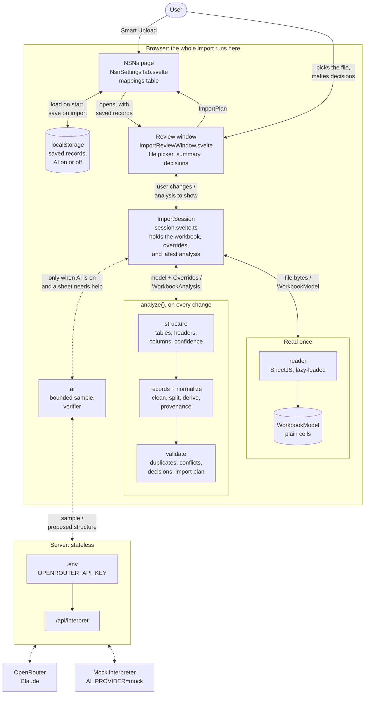
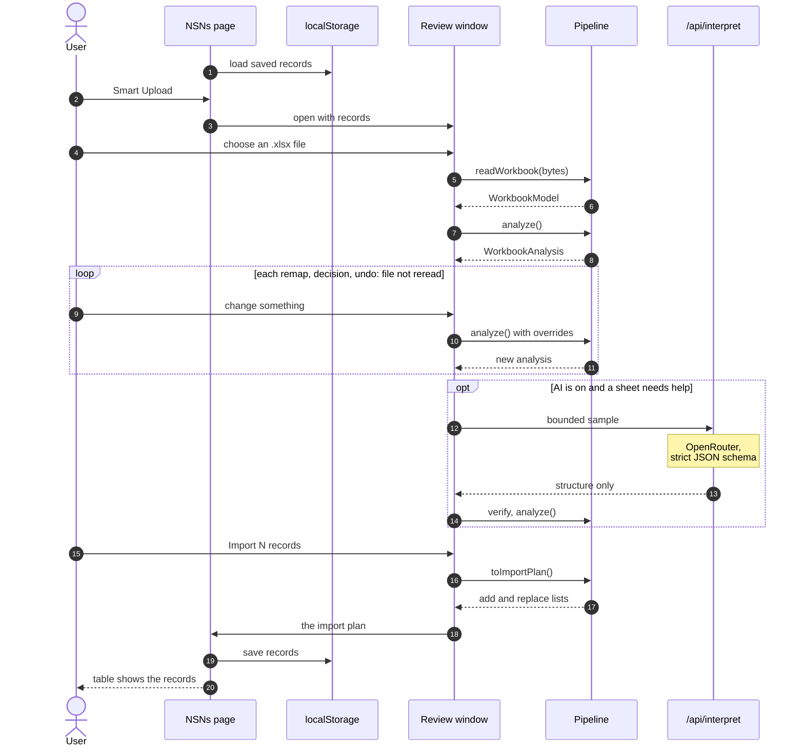

# NSN Smart Upload - Design Note

This is the design note required by `TASK_SPEC.md` ("Deliverables", item 3).
It describes what is built, why, and what is not supported.

Status (2026-10-24): everything described here is merged and tested; on `main`, 605 tests and 13 Playwright browser tests pass.
Questions waiting on a product decision are in [`OPEN-DECISIONS.md`](OPEN-DECISIONS.md).

## In one minute

Users upload messy Excel workbooks: several sheets, title rows, repeated headers, metadata columns, two part numbers in one cell, sheets that only talk about NSNs.
The importer reads every sheet, finds the real tables, works out which column is which, cleans each value, and shows a review window before anything is saved.

Three ideas carry the design:

1. **Values decide, headers only nominate.** A column called `Part` full of UUIDs is not a part column. Every mapping is checked against the actual values below the header.
2. **Automate what is certain, hold back what is not.** Certain decisions (skip a repeated header, split `12669555 / RVX08212` into two records) are applied and logged with an undo. Uncertain ones (two sheets disagree on a description) are excluded from import and queued with a suggested answer. Nothing uncertain is imported silently.
3. **Every value is traceable to a cell.** Each imported value records the file, sheet, row, cell, original text, and every transformation applied. Values computed from other cells (a NIIN derived from an NSN) are labeled "derived".

The default path is fully deterministic and makes no network request.
An optional AI fallback can propose where a table is when the rules are unsure; it never supplies values, and every proposal is verified against the workbook.

## Glossary

| Term | Meaning | Example |
| --- | --- | --- |
| NSN | National Stock Number: 13 digits, usually written `4-2-3-4`. It is the FSC followed by the NIIN. | `5305-01-658-2565` |
| FSC | Federal Supply Class: the first 4 digits of an NSN, the item's category. | `5305` (screws) |
| NIIN | National Item Identification Number: the last 9 digits. Its first two digits are the country code (`00`/`01` USA, `21` Canada). | `016582565` |
| CAGE | 5-character code identifying a manufacturer. | `0BWZ1` (PENCOM) |
| Part number | The manufacturer's own reference. Free format: hyphens, slashes, spaces, and suffixes are meaningful. | `6-32X1/4PH-PN-SQCN-SEMS-MS-SS-P` |

A record needs at least one of part, NSN, or NIIN. One part can legitimately have several NSNs, and one NSN several parts.

## Architecture at a glance

The whole importer runs in the browser.
The only server code is one stateless route that forwards an AI request after the user turns AI on; there is no database.

Start at the top: the user opens Smart Upload on the NSNs page, picks a file in the review window, and `ImportSession` drives the pipeline.
On a two-way arrow labeled "a / b", "a" flows down and "b" flows back up.
Dotted arrows are the optional AI path, the importer's only network traffic.



**What is stored where:**

| Where | What | Lifetime |
| --- | --- | --- |
| `localStorage` key `nsn-upload-interview-task:mappings` | The saved mapping records (part, description, NSN, NIIN, CAGE, plus id, created date, and status) as JSON. Read when the page loads, and passed to the pipeline so it can find duplicates of saved records and conflicts with them. Written when the user imports or clicks "Reset demo data"; until the first write, the page shows built-in demo records. | Until the browser's site data is cleared |
| `localStorage` key `nsn-upload-interview-task:ai-assistance` | Whether the user turned AI assistance on, so the choice survives a reload. | Same |
| Memory, inside `ImportSession` | The uploaded file's `WorkbookModel`, the user's `Overrides` (remaps, included tables, decisions, accepted AI tables, unchecked rows), and the latest `WorkbookAnalysis`. | Until the review window closes or another file is chosen; only the records the user imports are kept |
| Server | Nothing. The route reads `AI_PROVIDER`, `OPENROUTER_API_KEY`, and `OPENROUTER_MODEL` from the environment on each request; the key never reaches the browser. | n/a |

The AI sample leaves out hidden sheets, rows, and columns and system metadata columns, and the reply carries structure only (which rows and columns form a table), never values; section 7 has the details.

### A typical session



## How it works

```text
.xlsx file
  -> reader      readWorkbook()       bytes -> WorkbookModel (cells, sheets, merges, hidden rows/columns)
  -> structure   analyzeStructure()   find each sheet's table, header row, column mapping, sheet status
  -> records     buildRecords()       one candidate record per data row: normalize, split, derive, provenance
  -> validate    finalizeAnalysis()   duplicates, conflicts, automatic and pending decisions, summary
  -> review window (user checks, corrects, accepts)
  -> toImportPlan()                   add new records; replace saved ones the user chose to overwrite (browser storage)

  ai  (optional)  sampled sheet -> /api/interpret -> OpenRouter -> verify -> proposed tables
```

All of it lives in `src/lib/import/`, one directory per stage, joined by the typed contracts in `model.ts`.
`analyze(model, existing, overrides)` runs structure -> records -> validate and is a pure function.
The review window keeps the parsed workbook and an `Overrides` object (column remaps, decision choices, accepted AI tables, rows the user unchecked).
Every user change re-runs `analyze()` with new overrides; the file is never read again.

### From a cell to a record

The deterministic path, with the file that owns each step (all under `src/lib/import/`):

| Step | File | What it does |
| --- | --- | --- |
| 1. Read the file | `reader/index.ts` | The only code that uses SheetJS. It turns the `.xlsx` into the library-neutral `WorkbookModel` from `model.ts`: sheets, cells with their text and type, merges, hidden rows and columns. Values come from the file's cells, not from scraping text. |
| 2. Find the header row | `structure/detect.ts` (`detectTable`) | Tries each header-like row among the first 30 non-empty rows and scores the mapping it would produce on up to 200 rows below it (section 2). |
| 3. Read header words | `structure/header.ts` (`matchHeader`) | Normalizes the header text and matches a small vocabulary word by word; modifier words make a match weak. No regular expression decides the mapping. |
| 4. Check column values | `structure/values.ts` (`checkValue`) | Checks each cell under a column against a field, using the same normalizer that later cleans the values. |
| 5. Score columns | `structure/columns.ts` (`confidenceFor`) | Turns header strength and pass rate into High, Medium, or Low (section 2). |
| 6. Rows and table status | `structure/table.ts` (`materialize`) | Skips blank, hidden, and repeated-header rows, decides Ready or Needs review, and writes the reasons shown in "Why this classification". |
| 7. Clean each value | `normalize/fields.ts` | Cleans and validates a cell that is already known to be, for example, in the NSN column (section 3). |
| 8. Build records | `records/table.ts` | One record per data row: splits multi-value cells, derives the NIIN from an NSN or an NSN from FSC + NIIN, and records provenance. |
| 9. Decide | `validate/` | Duplicates, conflicts, automatic and pending decisions, summary, import plan. |

Regular expressions appear only at the lowest level, for exact shape checks: separators, "exactly 13, 9, or 4 digits", "5 letters or digits", and recognizing UUIDs, URLs, and dates (`identifiers.ts`, `normalize/fields.ts`).

## Walkthrough: the three example workbooks

These are also the regression fixtures; the numbers below are asserted by `tests/acceptance/fixtures.test.ts`.

**WOW NSN list** (a Dynamics 365 export).

- The very-hidden `hiddenSheet` is ignored.
- Columns A-C (`(Do Not Modify) Part` with UUIDs, a checksum, a modified date) are zero-width and never mapped. `Part Number` (D), `NSN` (E), and `Nomenclature` (F) are, with the reason "127 of 129 values are valid NSNs".
- 179 rows become 180 records, because D136 holds two part numbers on two lines and is split.
- `E134` (`12663107`) and `E166` (`280-035-330-101F`) are reported as malformed NSNs. E134's message adds "same value as part number in Active Parts!D134", a likely paste into the wrong column. Both rows still import their valid part number automatically, and the malformed NSN is never imported.

**Statz Geier & Bluhm list**.

- `G & B P/N` is recognized as the part column despite the vendor prefix. `Dwg Number` also holds part-like values but has no part header, so it is only offered as an alternative.
- The blank rows 32-33 and the repeated header on row 34 are skipped, so both blocks form one table of 54 records.
- Four NIINs appear under two or three different FSCs (for example `011066157` as 5210, 5220, and 6685). A NIIN has one FSC at a time, so 9 records get an `fsc-niin-mismatch` warning; all are still imported.

**PENCOM procurement database** (six visible sheets).

- `NSN Cross-Reference` and `Part Number Intake` are ready tables with headers on row 2, below a merged title. About 26,000 styled empty cells per sheet are ignored.
- `Search Log` has real part and NSN pairs but only 2 of 3 values pass in each column, so it is "needs review" and held back.
- `Dashboard`, `Opportunity Matrix`, and `Sources & Notes` mention NSNs (`NSN Matchability (1-5)`, `Likely FSC`) but have no column whose values are identifiers, so they show "no importable table" with the reason.
- The same two part/NSN pairs appear on both ready sheets with different descriptions. That is a conflict: the button reads "Import 0 records (7 need review)" (the 4 conflicting records plus Search Log's 3 held-back rows) until the user decides; "Accept all suggestions" prefers the cross-reference records (more fields, including CAGE `0BWZ1`), leaves Search Log out, and imports 2 valid records.

More demo files, each with its expected behavior, are in `docs/demo-workbooks/` (see its README): an unfamiliar header that triggers the AI path, an NSN that contradicts its NIIN, a changed copy of a saved PENCOM record, and one file packed with messy cases.

## 1. Table and header detection

**Sheets.** Every sheet is inspected. Hidden and very-hidden sheets are listed as "ignored because hidden". Every sheet gets a status (`ready`, `needs-review`, `no-table`, `hidden`) and human-readable reasons.

**Used area.** The reader computes each sheet's value extent from cells that actually hold values. Excel's own range (`!ref`) is ignored because styled empty cells inflate it (PENCOM reports `A1:Z1000` for about 15 real rows).

**Header row.** Every header-like row (mostly short text) among the first 30 non-empty rows is tried as the header (`structure/detect.ts`). For each candidate, the columns are scored against up to 200 rows below it (section 2), and the candidate earns 3 points for each High column, 2 for Medium, and 1 for Low, plus 1 more for each Part, NSN, or NIIN column. The highest score wins; a tie goes to the earliest row. Title rows lose because they map nothing, and a merged title counts as one cell, not twelve. For Statz, row 1 scores 8: Part High (3 + 1) and NSN High (3 + 1).
A row that repeats an earlier candidate's labels is never tried on its own, so a stray bad value in the first block cannot make a repeated header win and drop the rows above it.

**Two-row headers.** When a label is split over two rows ("Part" above "Number", "National Stock" above "Number"), the row below a candidate is checked as a possible continuation.
A continuation row holds only short text (at most 3 words and 30 characters per cell, `-` counting as empty), and none of its cells passes the strict NSN, NIIN, FSC, or CAGE checks or looks like a part number.
Because short text could still be a first data row ("ABC", "Screw"), the row must also read as a header: a continuation word (`Number`, `No.`, `Name`, `Code`, `#`, `ID`, ...), a bracketed hint such as "(13 digits)", or a join that names a field the first row alone does not.
The joined header is scored like any other candidate and kept only when it beats the single rows; both rows then count as header rows, so the second one is never imported.
When the joined label matches worse than the first row alone (a hint row), the first row's label is used for matching while both rows still form the header.
A merged group label above a full header ("Identifiers" over "Part No.", "NSN", ...) still resolves to the full header on the second row.

**Header vocabulary.** It is deliberately small, because values do the real work:

| Field | Header words |
| --- | --- |
| Part | `part`, `part number`, `part no`, `part #`, `p/n`, `pn` |
| Description | `description`, `nomenclature`, `item name` |
| NSN | `nsn`, `national stock number` |
| NIIN | `niin`, `national item identification number` |
| CAGE | `cage`, `cage code` |
| FSC | `fsc`, `federal supply class` |

Matching is token-based after normalizing case, punctuation, whitespace, and line breaks, so vendor prefixes still match (`PENCOM Part Number`, `G & B P/N`, `Part\nNumber`).
Modifier words make a match **weak**: `found`, `status`, `date`, `url`, `notes`, `equivalent`, `family`, `matchability`, `do not modify`, `checksum`, `id`, and similar. That is why `NSN Found` and `(Do Not Modify) Part` do not count as strong headers.
A label longer than 5 words or 40 characters reads as a sentence, not a header.
A word containing digits also makes a match weak, because it marks a value rather than a label: a part number such as `PN-4410` starts with the header word `pn` and must not be mistaken for a repeated header. As a side effect, a header such as `Part Number 2` is weak, so its column reaches at most medium confidence.

**Table extent.** Data runs from the row below the header down the used area. Inside it, these rows are skipped and listed with a reason: blank rows, hidden rows, repeated header rows (most mapped columns repeat the header text or name the same field; a repeated two-row header skips both rows), rows with values only in unmapped columns (PENCOM's template rows 5-7), and trailing totals rows ("Total", "Subtotal", "Grand total", "Sum" in an identifier column with no other identifier on the row), which are skipped as footers and left out of the pass rates.
Data stops early only before a clearly different table's header, so a stacked second table is not read through the first table's mapping.

**One table per sheet.** If a sheet has a second, different table, it is mentioned in the sheet's reasons but not imported (see Tradeoffs).

## 2. Confidence scoring

Confidence answers one question per column: how sure are we that this column holds this field?
It is computed by one function, `confidenceFor` in `structure/columns.ts`, from two measurements.

**Measurement 1: how well the header matches** (`structure/header.ts`).

| Strength | When | Examples |
| --- | --- | --- |
| Strong | The header contains a vocabulary phrase (section 1) and nothing that undermines it. Extra words such as a vendor name are fine. | `G & B P/N`, `PENCOM Part Number`, `NSN`, `Government Item Name` |
| Weak | The vocabulary phrase comes with a modifier word (`found`, `status`, `family`, `notes`, ...), a word containing digits, or the text reads like a sentence (more than 5 words or 40 characters). | `NSN Found`, `Part Number / Family`, `(Do Not Modify) Part` |
| None | No vocabulary phrase at all. | `Dwg Number`, `Manufacturer`, `Qty` |

**Measurement 2: the pass rate**, the share of the column's non-empty cells that pass the field's value check (`structure/values.ts`).

| Field | Value check |
| --- | --- |
| NSN / NIIN / FSC / CAGE | The strict normalizer: exactly 13 / 9 / 4 digits, or 5 letters or digits. |
| Part | Plausibility: 1-40 characters, contains a digit, not a UUID, URL, email, date, or sentence. |
| Description | Contains letters and does not look like an identifier. |

**The decision table** that combines them:

| Header | Pass rate | Confidence |
| --- | --- | --- |
| Strong | 90% or more | **High** |
| Strong | 60% to 90% | Medium |
| Strong | 50% to 60% | Low |
| Weak | 90% or more | Medium |
| Weak | 60% to 90% | Low |
| None (NSN and NIIN only, at least 3 values) | 95% or more | Medium |
| Anything weaker | | Not mapped |

**Worked examples from the real files:**

| Column | Header | Pass rate | Result |
| --- | --- | --- | --- |
| Statz A `G & B P/N` -> Part | Strong (`p/n`; `G & B` is a vendor prefix) | 54 of 54 plausible (100%) | High |
| Statz C `NSN` -> NSN | Strong | 54 of 54 valid (100%) | High |
| WOW E `NSN` -> NSN | Strong | 127 of 129 valid (98%) | High; the 2 failures become malformed-NSN issues on their rows |
| PENCOM Search Log F `NSN / Reference` -> NSN | Strong | 2 of 3 valid (67%) | Medium |
| PENCOM Search Log B `Part Number / Family` -> Part | Weak (`family`) | 2 of 3 plausible (67%) | Low |
| Statz B `Dwg Number` -> Part | None | 16 of 16 plausible | Not mapped: a part column needs a header; offered as an alternative |
| PENCOM `NSN Matchability (1-5)` -> NSN | Weak (`matchability`) | 0% (scores 1-5) | Not mapped |
| WOW A `(Do Not Modify) Part` -> Part | Weak, and the column is hidden | UUIDs fail | Not mapped |

Rules that keep this honest:

- Only NSN and NIIN can be mapped from values alone, because only they have strict formats. A part, description, CAGE, or FSC column needs a header.
- Values that only pass after repair (a number turned into text, a NIIN with restored leading zeros) count only when the header names the field. Otherwise a `Qty` column of small numbers would look like 100% valid NIINs.
- Excel error cells and trailing totals rows do not count either way.
- Hidden and zero-width columns are never mapped automatically.
- Assignment is one-to-one: each column gets at most one field and each field at most one column, best evidence first.

**From column confidence to table status** (`structure/table.ts`).
A table is **Ready** when all three hold: its best identifier column (Part, NSN, or NIIN) is High, none of its identifier columns is Low, and no two columns compete for the same identifier field.
Otherwise it is **Needs review**, and the reason names the column that held it back (for Search Log: its best identifier column, the NSN in column F, is only Medium).
A sheet with no column that qualifies for Part, NSN, or NIIN has **no importable table**.
Ready tables are included automatically; needs-review tables are held back as a pending decision (section 4).
Statz reads "Ready: Part column A 'G & B P/N' is high confidence"; PENCOM's Search Log is held back.

**Every result explains itself.** Each mapping carries its evidence as text, for example "Header 'NSN' matches NSN; 127 of 129 values are valid NSNs", shown next to the column and in its (i) tooltip.
The same code scores columns found by detection, columns the user remaps, and tables proposed by the AI, so a column gets the same confidence however it was mapped.

**User corrections.** Remapping or excluding a column marks it "Set by user" (high confidence) and recomputes the table. Mapping a field that another column already has unmaps the other column with the reason "Replaced by user mapping of column X", so one column is never silently mapped to two fields and a field is never claimed twice.

**Why fixed thresholds.** Confidence is rule-based, with explicit and tunable thresholds; it is not a statistical model, and that is deliberate.

- The method is systematic: every column gets the same two measurements, and one decision table turns them into a level. It is deterministic (the same workbook always gives the same answer) and every result can be explained in one sentence by pointing at the header match and the measured pass rate, which is what TASK_SPEC asks for ("clear decisions, explicit uncertainty, and debuggable behavior").
- The cutoffs (90%, 60%, 50%, 95%, at least 3 values) are hand-picked named constants at the top of `structure/columns.ts`. They were not learned from data; they were tuned on the three example files and the synthetic test workbooks, and the acceptance suites pin the results.
- The cost of sharp cutoffs is hard edges: a column at 89% is Medium where one at 90% is High. In practice that only changes whether a table is Ready or held back for review, never whether a wrong value is imported, because every value is still validated on its own (section 3).
- The natural next step is to calibrate the cutoffs on a larger set of real customer workbooks: label which tables a person would import, and choose the thresholds that hold back the fewest good tables without letting a bad one through.

## 3. Normalization

Both the original text and the normalized value are kept for every cell.

Normalization does not find identifiers; the column mapping does.
`normalize/fields.ts` only cleans and checks a cell that is already known to be, for example, in the NSN column, using regular expressions for the label, the separators, and the digit count.
It does not search free text, so an NSN written inside a sentence in a notes column is not picked up.
Splitting an NSN into its FSC and NIIN, or building an NSN from FSC + NIIN, happens later in `records/table.ts` (Derivation, below).

| Field | Rule |
| --- | --- |
| NSN | Strip a leading `NSN:` label, whitespace (including non-breaking and zero-width spaces), hyphens, and Unicode dashes; require exactly 13 digits. Errors say what the value looks like, for example "has 9 digits and looks like a NIIN". |
| NIIN | Same stripping; exactly 9 digits. A number cell with fewer digits gets its leading zeros restored (`16582565` -> `016582565`) with a warning, because Excel drops leading zeros from numbers. |
| FSC | Exactly 4 digits; used only to derive an NSN. |
| CAGE | Trim, uppercase, exactly 5 alphanumerics. A number cell gets its leading zeros restored with a warning. |
| Part | Trim only. Hyphens, slashes, spaces, asterisks, and revision suffixes are kept (`457985-1 B`, `10931023*92`, `BH011-HT REV 000`). A number cell is converted to text with a warning. A date cell is invalid, because Excel destroyed the original value. A parenthetical note (`12273108 (EATON M144E)`) is kept verbatim with a warning. |
| Description | Trim; internal line breaks kept. |

General rules:

- A cell holding only `-` (or a lone en dash, em dash, or minus) is empty.
- Windows and old Mac line endings become `\n`.
- Identifiers are never converted through JavaScript numbers, so leading zeros and long digit strings survive (`13211E9213` stays text). Large integers are rendered exactly.
- Formulas are never evaluated; their cached results are read. Rich text is read as plain text.
- An Excel error cell (`#N/A`) is a rejected value with an issue, never an empty cell.

**Multi-value cells.** Only part, NSN, and NIIN cells are split, and only on line breaks, never on spaces or punctuation. A part cell is split only if every line looks like a part number; NSN and NIIN cells only if every line is valid. A row with exactly one multi-valued identifier becomes one record per value, each labeled "1 of 2 from D136"; this is applied automatically and can be undone ("keep as one"). A row with two multi-valued identifiers is ambiguous and held back (pair them in order, keep as one, or exclude; pairing is only offered when the counts match).

**Derivation.** A valid NSN gives the NIIN. A valid FSC plus a valid NIIN without an NSN gives the NSN. Derived values are labeled with the cells they came from, and a value that failed validation is never replaced by a derived one.

**Rejected values.** A value that fails validation is shown in the review window with its issue and is never imported. If the row still has another valid primary identifier, the valid portion imports automatically, and the user can switch that row to "exclude".

## 4. Deduplication, conflicts, and automatic decisions

**Identity.** Two records describe the same mapping when they have the same part (compared uppercased, with internal whitespace collapsed) and the same NSN, or the same NIIN when there is no NSN. CAGE splits them only when both have a CAGE and the CAGEs differ.
A part with several NSNs is therefore several records, never a duplicate.
Comparison uses normalized values; the stored values stay as written.

**Decisions.** Everything the importer decides on the user's behalf is a decision listed in the review window. Each decision is either applied automatically (with an undo) or pending (held back from import, with a suggested option).

| Situation | What happens | State |
| --- | --- | --- |
| Ready table | Included | automatic |
| Needs-review table, including AI proposals that fail the thresholds | Held back; suggested: exclude | pending |
| One multi-valued identifier in a row | Split into one record per value | automatic, undo: keep as one |
| Two multi-valued identifiers in a row | Held back; suggested: pair in order (only when counts match), else keep as one | pending |
| Malformed field, another valid primary identifier present | Import the valid portion, drop the malformed value | automatic, undo: exclude row |
| Exact duplicate inside one table | Later copies dropped | automatic |
| Same identity on two sheets, compatible fields | Merged into one record, each field keeping its own source cell | automatic |
| Same identity on two sheets, conflicting description or CAGE | Held back; suggested: the record with more filled fields | pending |
| Already saved in the browser, with the same values or only missing ones | New copy dropped | automatic, undo: keep |
| NSN contradicts its own NIIN or FSC | Held back; keep the NSN, keep the NIIN and FSC, or exclude the row; suggested: exclude | pending |
| Already saved, but with a different description or CAGE | Held back; keep saved, replace saved (same id and created date), or keep both; suggested: keep saved | pending |

Once the user settles a conflict, the record they kept carries it as a note rather than a warning, so it imports as valid (PENCOM after "Accept all suggestions": 2 valid records).

Same NIIN under different FSCs: a warning on every record involved, no decision, all imported. The message names every FSC and its rows: "NIIN 011066157 (one catalog item) appears with 3 FSCs in this upload: 5210 (row 37), 5220 (this row), 6685 (row 39). An item has one FSC at a time, so at most one of these NSNs is current".

"Accept all suggestions" resolves every pending decision in one click. Pending items never block the rest: the import button always says how many records will import and how many need review.
A stored choice that no longer applies after a remap (for example, preferring a record that has left its group) falls back to the default policy instead of failing.

**Issue types.** Every problem is a structured issue on a record or field, never one file-level error: invalid identifier, missing primary identifier, duplicate in table, duplicate across sheets, duplicate in storage, conflict, ambiguous multi-value cell, low-confidence mapping, split from a multi-value cell, FSC/NIIN mismatch, suspicious value, and missing optional field.
Missing description or CAGE is a warning only where the column exists; if the table has no such column, one table-level notice replaces a warning on every row.

**Summary counts** cover included and pending tables; records of an excluded table stay available so it can be re-included.

## 5. Provenance

Every value in a candidate record carries: workbook filename, sheet, row, column, source cell (the top-left cell for merged cells), original text, normalized value, the ordered list of transformations (`trim`, `strip-separators`, `restore-leading-zeros`, `split-multi-value`, `derive-niin-from-nsn`, and so on), and whether it came from the source or was derived (with the cells it was derived from).
A merged record keeps each field's own provenance, so the user can see which sheet supplied the CAGE and which supplied the description.
Issues cite fully qualified cells (`Active Parts!E134`), and the review window shows all of it in a per-row provenance drawer.

## 6. Review window

Summary first, details on demand: a new user sees in seconds what will import and what needs them, and every detail stays one click away (decision D20; the [prototype](prototypes/review-window/index.html) it was built from).
The file is read once; every change re-runs the analysis on the kept workbook.

**Header** (always visible):

- One sentence: "2 of 6 sheets have importable tables · 7 rows · 3 decisions need you", or for a clean file "1 of 2 sheets has an importable table · 179 rows → 180 records · nothing needs you".
- Chips for non-zero counts only (valid, warnings, invalid, duplicates, in conflict, split, held back); clicking one opens Rows with that filter.
- "Accept all suggestions" when anything is pending, and an import button that always says how many records import and how many need review: "Import 0 records (7 need review)".

**Decision stage** (only when something is pending): one decision at a time, "Needs your decision · 1 of 3" with progress dots.
Each decision shows its explanation, a side-by-side comparison (cross-sheet conflicts highlight the differing fields; an identifier conflict lines the NSN's FSC and NIIN up against the NIIN and FSC cells; a storage conflict shows the saved record next to the new one), and its options with the suggestion preselected.
"Apply and continue" moves to the next decision; "Skip for now" and "Previous" move between them. When none are left, "All 3 decisions made" lists each choice, with "Review my choices".

**Worth a look** (only when records import with warnings): one plain line per kind of warning, for example "2 rows had a malformed NSN · rows 134 and 166; the part number imports, the bad NSN does not", and "Show these rows".

**Details**, five collapsed sections, each with a one-line summary, plus "Expand all":

- **Sheets:** "2 ready · 1 needs review · 3 nothing to import". Each sheet has its status badge, include switch, and "Why this classification"; sheets with nothing to import and hidden sheets are folded.
- **Columns:** the mapped fields per table. Each mapped column shows its header, evidence ("127 of 129 values are valid NSNs"), field picker, and confidence; unmapped columns fold into "3 more columns not imported", each still remappable. Opens by itself when a column is Medium or Low, or was remapped.
- **Rows:** titled with the same row count as the summary sentence, with held-back rows counted apart ("Rows (4) · 3 held back"); the preview has status tabs for non-zero counts, a sheet filter, search across values and cell references, and 100 rows per page; derived values say "derived from E2" and split rows "1 of 2 from D136". Rows of held-back tables fold into "Search Log · 3 rows held back, not importing".
  Each importable row has a checkbox: unchecking it leaves that one record out ("Excluded by you", and the import count drops by one) without changing any other row or decision, and checking it again brings it back. "Worth a look" then stops listing it, since that line promises its rows still import.
  Clicking anywhere else on a row opens the provenance drawer: for each field the cell, original text, normalized value, transformations, and origin.
- **Applied automatically:** the automatic decisions grouped by kind, each with undo.
- **AI assistance:** the opt-in switch, its status, and "How AI assistance works". Opens by itself when a sheet could use AI.

**Import** adds approved records to browser storage, replaces saved records the user chose to overwrite (keeping their id and created date), confirms the result ("54 records added to your NSN table"), and returns to the mappings table.
The layout works down to phone width without horizontal scrolling.

## 7. AI fallback boundary

**When it runs.** Only when the user has turned on "AI assistance" (off by default, remembered per browser) and the deterministic analysis flagged a sheet: either at least 3 cells look like NSNs or NIINs but no ready table was found, or two columns compete for a primary field. Conventional workbooks, including all three examples, never trigger it.

**What is sent.** A bounded sample of the flagged sheets only: at most 3 sheets, 60 rows per sheet (the first 40 non-empty rows plus 20 spread over the rest, always including the last), 30 columns, 120 characters per cell, and 3000 cells in total. Hidden sheets, hidden rows and columns, and columns that look like UUIDs, checksums, or timestamps are never sent.

**Where it goes.** The browser posts the sample to the app's own server route `/api/interpret`, which holds the `OPENROUTER_API_KEY` (it never reaches the browser), validates the request again, and calls OpenRouter.
The request uses a strict JSON schema (`response_format: json_schema`, `strict: true`) and only routes to providers that support it (`require_parameters: true`).
The default model is `anthropic/claude-opus-5.5`, overridable with `OPENROUTER_MODEL`. The reply is validated with Zod on the server and again in the browser.
Without a key, the route reports "unavailable" and the toggle is disabled with that reason; everything else works.
The review window asks the route whether AI is available only when the user turns AI on, so opening the window and analyzing a workbook send nothing; the E2E tests check this.

**What comes back.** Structure only: sheet name, A1 range, header row numbers, and for each mapped field its column number and the header text the model read, plus a confidence and short reasons. No cell values, so the model cannot invent identifiers.

**Verification** in the browser, against the full workbook. A proposal is rejected, with a specific reason shown to the user, when:

- the sheet was not in the request, does not exist, or is hidden;
- the range does not parse or lies outside the used area;
- a header row is outside the range, or no data rows are left below it;
- a column is outside the range, hidden, or was not in the request;
- a column maps to two fields, or a field to two columns;
- the claimed header text does not match the real header cell (this catches off-by-one rows);
- it maps no part, NSN, or NIIN column.

Accepted proposals are scored by the same code and thresholds as the deterministic path (`materializeTable`), using every row of the sheet rather than the sample.
Below 0.8 model confidence, a table is capped at "needs review".
An AI table is applied automatically only if it reaches `ready` on the real cells; otherwise it is a pending decision with an "AI" badge.

**Prompt injection.** Cell text is treated as untrusted data: the system prompt says so, the sample is wrapped so cell text cannot close its block, and nothing the model writes is acted on except the structure, which is verified.
A live smoke test with a planted "ignore all previous instructions" cell returned the correct table and noted the instruction as ignored.

**Testing without a key.** `AI_PROVIDER=mock` swaps in a mock interpreter built from the request alone; its proposals use confidence 0.6, so they always land as pending decisions. Adversarial mock answers (unknown sheet, out-of-range column, off-by-one header, duplicate field, hidden column) are all rejected by the verifier in tests.

The provider sits behind a small interface (`WorkbookInterpreter`), so it can be mocked or replaced.

## 8. Performance and safety

- SheetJS is loaded with a dynamic import when the first file is read, so it is not in the initial page bundle.
- Detection is linear in rows and columns; duplicates are grouped through hash keys.
- Measured end to end (`readWorkbook` + `analyze`, Node, synthetic 8-column sheets): 10,000 rows in 0.3 s; 50,000 rows (5.5 MB) in 1.4 s, of which 0.8 s is analysis. There is no automated performance test.
- Analysis runs on the main thread. The window shows "Reading" and "Analyzing" states, but the page is blocked while they run, and every remap re-runs the analysis (0.8 s at 50,000 rows). Moving it to a Web Worker is open decision OD1; the pipeline is pure, so the move is mechanical.
- Limits, each with a specific error: 20 MB file, 200 MB once unzipped, 50 sheets, 100,000 rows per sheet, 2,000,000 cells.
- Zip bombs are stopped before SheetJS unzips anything: the reader adds up the uncompressed sizes the zip declares and rejects the file above 200 MB, and it caps each entry's actual inflated bytes at its declared size, so a zip that lies about its sizes is reported as damaged. A legitimate workbook at the 2,000,000-cell limit unzips to about 90 MB; unguarded, SheetJS would have inflated a 1 GB bomb.
- Files are checked by signature before parsing: random bytes are "corrupt", and an encrypted workbook is reported as password-protected.
- Only `.xlsx` is accepted. Formulas are never evaluated, macros and external links are never run, and cell text is always rendered as text.
- No network request happens during parsing or import; only the opt-in AI path calls `/api/interpret`.

## 9. Testing

- Unit tests per module: reader against the 3 real files and synthetic workbooks; normalizers table-driven over every rule above; structure on hand-built sheet shapes and the real files; records, validation, and the AI request builder, verifier, and route.
- Acceptance suites in `tests/acceptance/` (part of `pnpm test`; 605 tests pass in total on `main`): the real workbooks end to end through `readWorkbook` and `analyze`, plus "unseen" workbooks written in the tests with ExcelJS (a different writer than the fixtures) covering titles above merged headers, line-break headers, part numbers that begin with a header word (`PN-4410`), numeric NIINs, FSC + NIIN derivation, cross-sheet duplicates and conflicts, hidden sheets, a notes sheet that mentions NSNs, storage duplicates, multi-line descriptions next to multi-line parts, and exact cell references for a table offset to `C5`.
- Every expected number for the example files was checked independently against the raw workbooks.
- A messy-case suite (`tests/acceptance/messy.test.ts`) adds 14 more unseen workbooks: a part cell merged down across several rows, numeric NSNs and CAGEs, `NSN:` prefixes and dash variants, formulas and `#N/A`, part numbers Excel turned into dates, filtered rows, a header on row 7 below instructions, FSC + NIIN only, a totals row, a malformed value above a repeated header, two stacked tables, and a two-row header. Two-row headers have their own cases in `structure/two-row.test.ts` (split labels, a group label above the header, a hint row, a repeated two-row header, and a guard that keeps a first data row as data). The demo workbooks in `docs/demo-workbooks/` are tested to behave as their README says.
- The acceptance suites also cover both F1 decisions: an unseen workbook whose NIIN contradicts its NSN, and PENCOM with a saved copy whose description differs, each through every option and the resulting import plan.
- Playwright E2E tests (`pnpm test:e2e`, Chromium against a production build, `AI_PROVIDER=mock`): each example file is uploaded, its sheet badges, chips, and decisions are checked, "Accept all suggestions" is used where needed, the records are imported and found in the mappings table, and no AI request is sent. A fourth test turns AI on for a synthetic sheet and checks the mock proposal and that exactly one request was made.
  Nine more (`tests/e2e/review-window.spec.ts`) cover the redesigned window: walking PENCOM's three decisions one at a time with focus moving to the next one, "Review my choices", a chip opening Rows with its filter, held-back rows folded outside the main list, the Columns open-by-default rule (closed on a clean file, open once an uncertain table is included or after a remap), "Worth a look" for WOW and Statz, including that it stays hidden when nothing imports with a warning, and unchecking a row to leave it out of the import and checking it again.

## 10. Dependencies

**SheetJS Community Edition 0.20.3 (`xlsx`)** reads the workbooks.
The starter's ExcelJS 4.4.0 cannot open 2 of the 3 example files: PENCOM and WOW were written by the .NET Open XML SDK with prefixed XML namespaces (`<x:workbook>`), which is valid but unsupported by ExcelJS.
SheetJS is installed from the vendor's tarball (`https://cdn.sheetjs.com/xlsx-0.20.3/xlsx-0.20.3.tgz`), because the npm registry package is stuck at 0.18.5, which has known security issues. The lockfile pins its hash. License: Apache-2.0.
Only `src/lib/import/reader/` imports it; everything else sees the library-neutral `WorkbookModel`, so the parser can be replaced by rewriting one directory.
Behaviors the reader corrects for: SheetJS parses almost any bytes as a one-sheet workbook (hence the signature check); it silently drops a sheet that fails to parse (the reader reports the damaged sheet by name instead); it may render long integers in exponent form (integers are rendered exactly instead); it reports a formula without a cached result as `0` (treated as empty); and styled empty cells are stored as cells (ignored for the used area).

**OpenRouter** (optional) serves the AI fallback through the server route; see section 7. **Zod** validates the AI request and response on both sides. **ExcelJS** is now a test-only dependency used to write synthetic workbooks.

## 11. Tradeoffs and unsupported cases

- **One table per sheet.** A second, different table on the same sheet is mentioned in the sheet's reasons but not imported.
- **Headers over three or more rows are not detected**; only the row directly below a candidate is checked as a continuation.
- **A five-letter word in a header's second row** (`Class`, `Model`, `Notes`) passes the strict CAGE check, so that row is never treated as a continuation and is read as data.
- **Only trailing totals rows are recognized as footers**, and only the words `Total`, `Totals`, `Subtotal`, `Grand total`, and `Sum`; a "Total" row between two blocks goes through the normal record checks.
- **Large workbooks block the page** while they are read and analyzed (section 8, OD1).
- **Derived values are not labeled after import.** The review window labels them; the mappings table does not yet (OD2).
- **A hidden sheet cannot be included on request** (OD4).
- **No fill-down of blank cells.** Only explicit merges are filled; a part number written once above several blank rows is not copied down, because that layout is a guess.
- **ISO date cells** (`t="d"`, which Excel does not write in `.xlsx`) are read as numbers.
- **A `no-table` sheet cannot be mapped by hand**; only the AI path can propose a table there.
- **Storage duplicates with only new information** (the saved record lacks a description that the upload has) are dropped rather than merged into the saved record.
- **Not interpreted:** cell colors, strikethrough, comments, and Excel Table objects.
- **Out of scope per TASK_SPEC:** a backend, authentication, enrichment from external NSN databases, `.xls` / `.xlsm` / CSV.

## 12. Future ideas

Deferred by the product owner; see the backlog in `docs/PLAN.md` for size and owner, and [`OPEN-DECISIONS.md`](OPEN-DECISIONS.md) for the items waiting on a decision.

- Calibrate the confidence thresholds on a larger set of real customer workbooks (section 2).
- Import several tables from one sheet.
- Run reading and analysis in a Web Worker.
- Merge new information into saved records instead of dropping the upload.
- Let the AI segment complex multi-value cells (for example `12345 / 67890 (alt)`), verified against the cell text.
- Let the user draw a table on a `no-table` sheet.

## Appendix: TASK_SPEC coverage

| TASK_SPEC requirement | How | Where it is tested |
| --- | --- | --- |
| Inspect every sheet; ignore hidden | Every sheet analyzed; hidden and very-hidden get status `hidden` | `structure/fixtures.test.ts`, acceptance (WOW, unseen hidden sheet) |
| Styled empty rows are not data | Used area from real values, not `!ref` | `reader/fixtures.test.ts` (PENCOM extents) |
| Tell tables from dashboards, notes, logs | Values must pass; modifiers and sentence-length labels are weak | acceptance (PENCOM statuses), unseen notes sheet |
| Classify every sheet; choose what to import; never import low confidence silently | Status + reasons per sheet; include decisions; needs-review held back | `validate/index.test.ts`, acceptance |
| Header below titles, merged titles, repeated headers, blank rows | Header scoring; merged cells count once; skipped rows with reasons | `structure/structure.test.ts`, acceptance (Statz rows 32-34) |
| Multiple table regions | One table per sheet; a second is reported, not imported | Known gap (section 11) |
| Header variants, prefixes, line breaks | Token vocabulary with strong/weak matches | `structure/header.test.ts`, unseen line-break header |
| Header split over two rows | Continuation rows joined into one header (section 1) | `structure/two-row.test.ts`, `tests/acceptance/messy.test.ts` |
| Values decide (UUID `Part` loses) | Pass rates; value-only only for NSN/NIIN | `structure/structure.test.ts`, acceptance (WOW) |
| UI shows header row, mapping, confidence; lets the user change or exclude; no double mapping | Mapping controls with evidence; one-to-one overrides | `structure/overrides.test.ts`, `components/import/session.test.ts` |
| Field normalization rules | Per-field normalizers with recorded transforms | `normalize/normalize.test.ts` |
| NSN from FSC + NIIN; NIIN from NSN; labeled derived | Derivation with `derivedFrom` | `records/table.test.ts`, unseen FSC + NIIN |
| `-` is empty; no number coercion; formulas and rich text; line endings | Normalizer and reader rules | `normalize/normalize.test.ts`, `reader/reader.test.ts` |
| Malformed optional field: field-level, import valid portion or exclude | Rejected values + `import-valid-portion` decision | `records/table.test.ts`, acceptance (WOW E134, E166) |
| Multi-value cells: split identifiers, keep descriptions, traceable | Newline splits with `split` provenance; ambiguous rows held back | `normalize`, `records`, acceptance (WOW D136), unseen |
| Distinguish all 8 issue types | Structured `IssueCode`s per record and field | `records`, `validate` |
| Duplicates use normalized values; one part, many NSNs is fine | Identity key; per-NSN records | `validate/index.test.ts`, acceptance (Statz) |
| Cross-sheet duplicates: prefer neither silently, show cells, choose/merge/exclude | Auto-merge compatible; pending conflict otherwise | `validate/index.test.ts`, acceptance (PENCOM) |
| Provenance for every value | `Provenance` on every field value | `records/table.test.ts`, unseen provenance check |
| Preview, filters, search, import approved only, recompute without rereading | Review window; `analyze()` re-run with overrides | `components/import/session.test.ts`, `tests/e2e/import.spec.ts` |
| AI: bounded input, structured output, verified, never invents identifiers, opt-in, no hidden content, works without a key, behind an interface | Section 7 | `ai/request.test.ts`, `ai/verify.test.ts`, `routes/api/interpret/server.test.ts` |
| Lazy parser, linear scans, limits, no network, no formula execution | Section 8 | `reader/reader.test.ts` (limits, file signatures), `reader/zip.test.ts` (zip bombs); performance measured by hand |
| At least one integration test on a real `.xlsx` | All three fixtures end to end | `tests/acceptance/fixtures.test.ts` |
